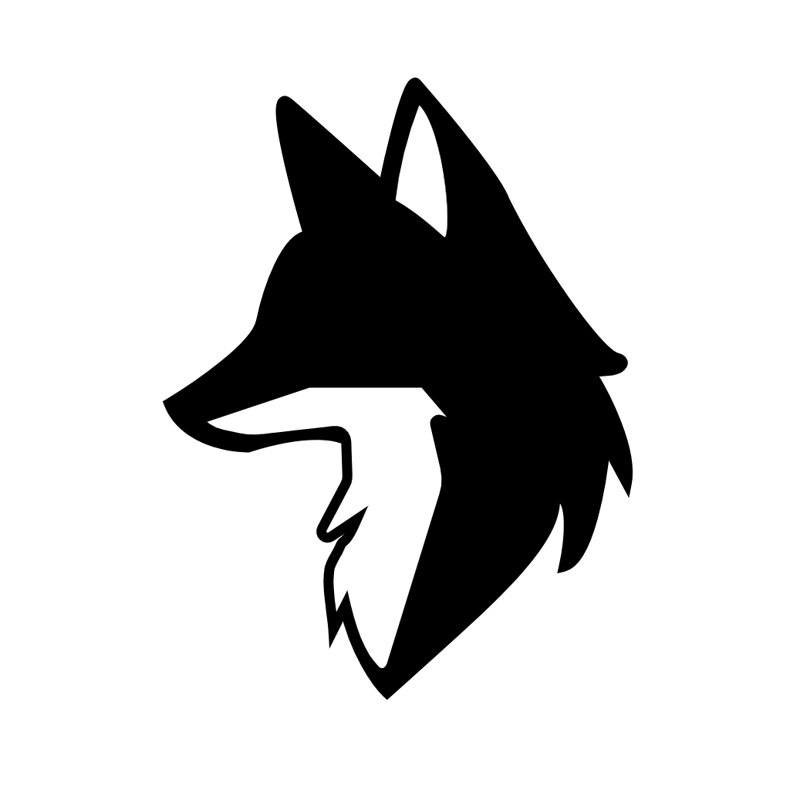

<div align="center">

<h1>
Inari
</h1>


[](https://www.gnu.org/licenses/agpl-3.0)

A web app that lets you chat with people nearby in games like Minecraft, etc.
</div>

## Tech stack

**Frontend** - Angular   
**Server** - Rust with WebSocket

## Architecture

```
inari/
  frontend/   Angular - Web app
  server/     Rust - WebSocket Server
  assets/  Static assets (images, SVG...)
```

## Environment variables

The project requires a `.env` file at the root of each service. Refer to the corresponding `.env.example` files.

## License

This project is licensed under the **GNU Affero General Public License v3.0 (AGPL-3.0)**.

Any modification must be released under the same license. Using this software as a network service (SaaS) also requires making the source code publicly available. Commercial use without complying with these terms is not permitted.
